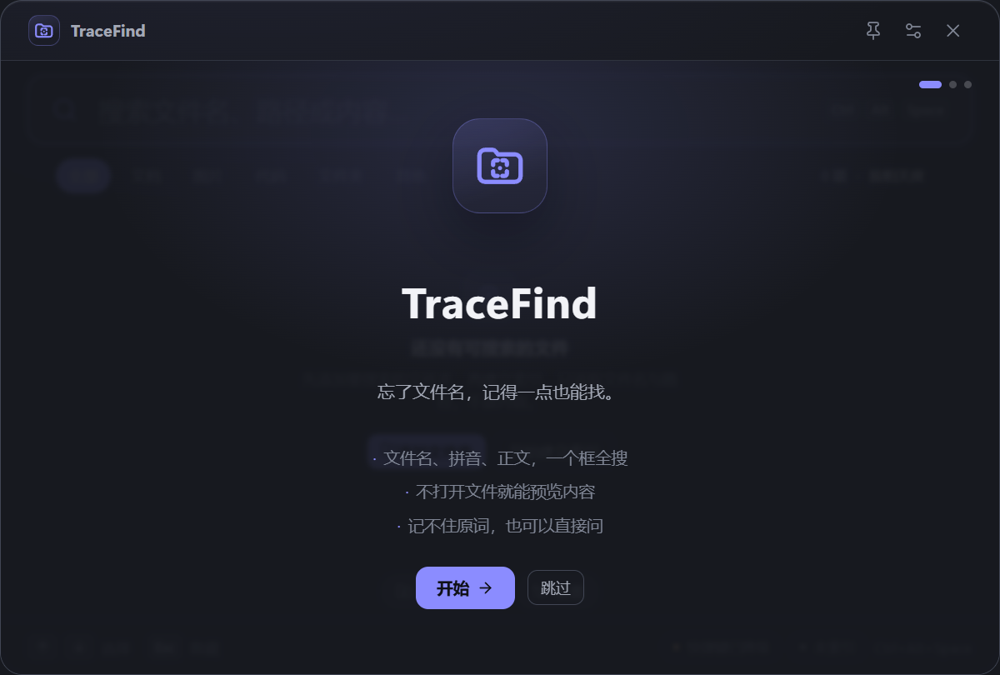
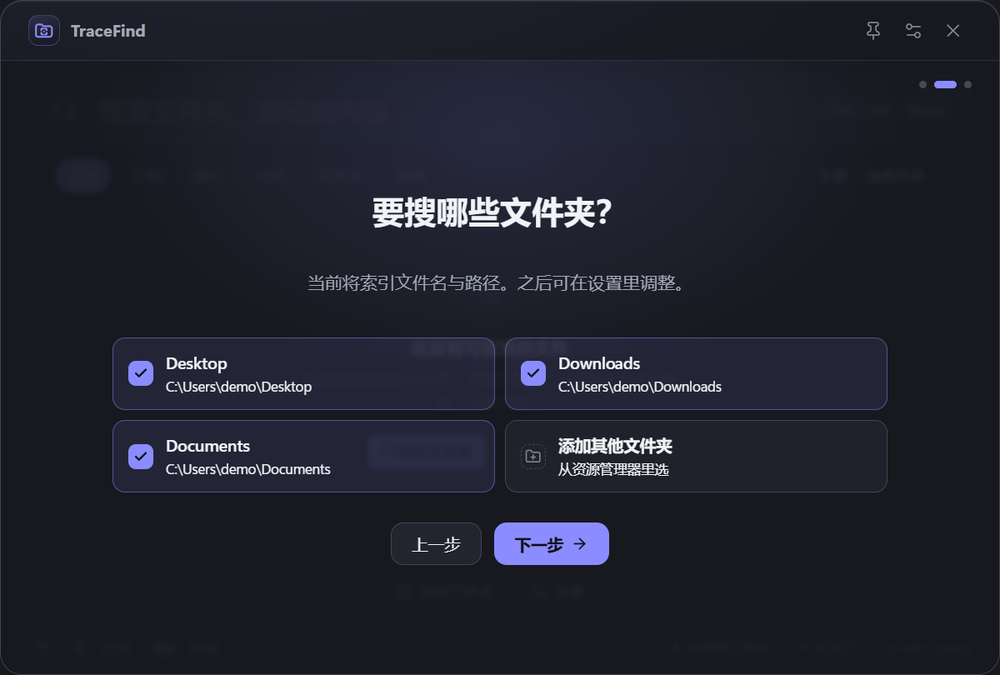
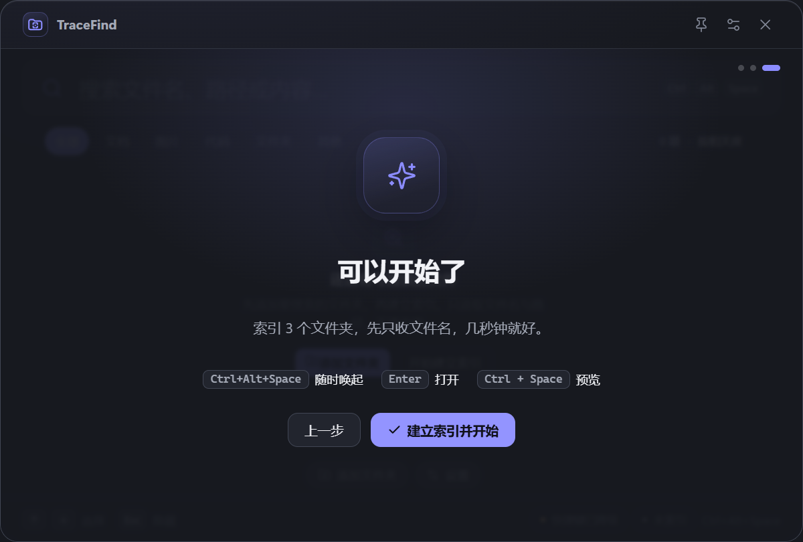
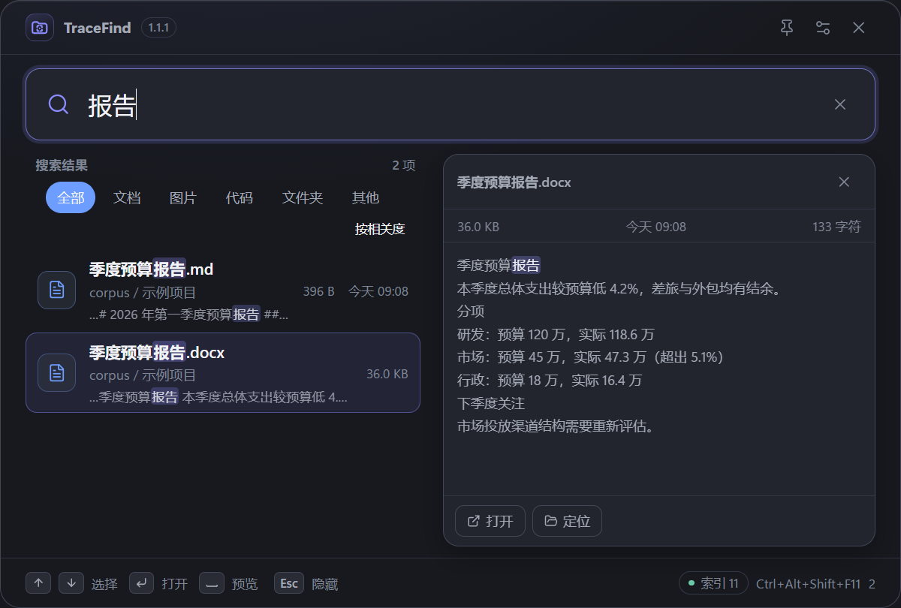
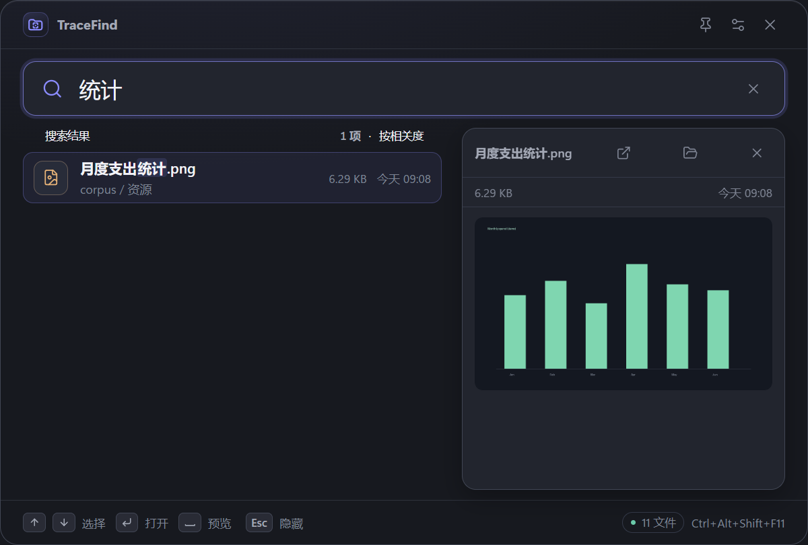
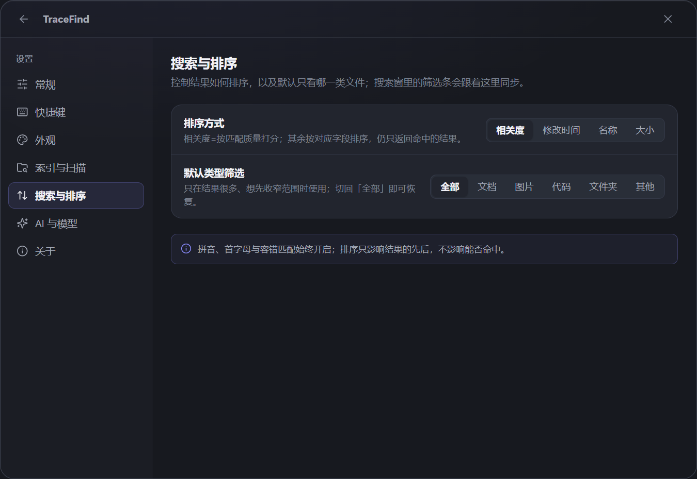
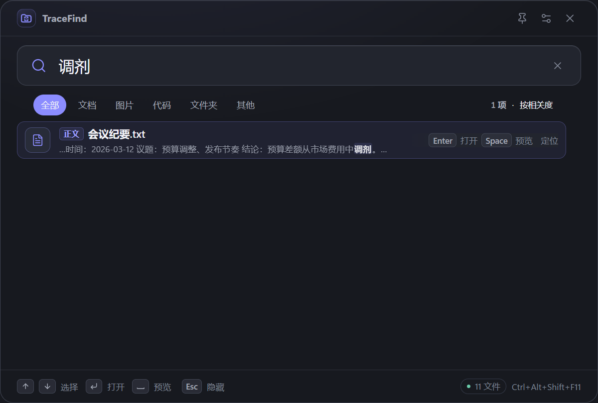
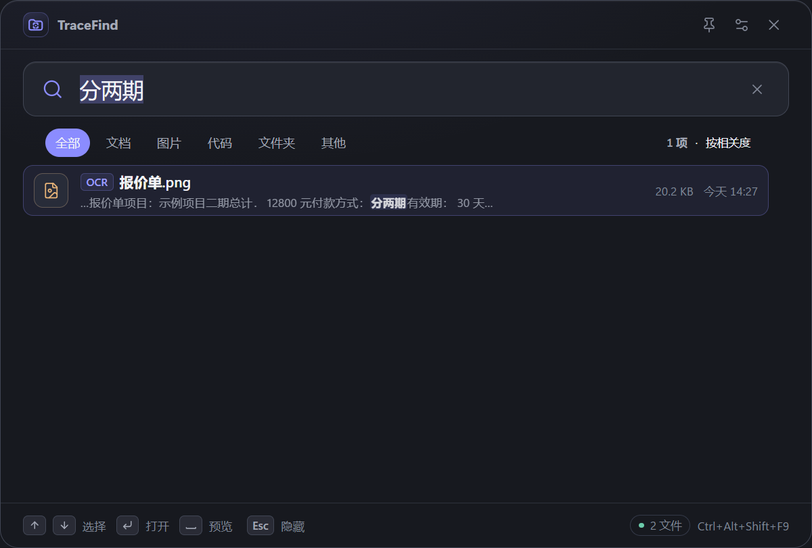
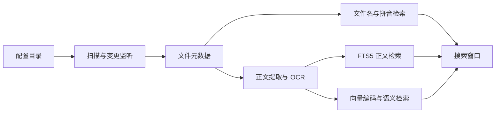

<p align="center">
  
</p>

<h1 align="center">TraceFind · 寻迹</h1>

<p align="center"><strong>忘了文件名，记得一点也能找。</strong></p>

<p align="center">
  Windows 本地文件搜索 · 文件名与拼音 · 正文与 OCR · 语义检索
</p>

<p align="center">
  <a href="https://github.com/fanfanhappy/TraceFind/releases/latest">下载 Windows 版</a> ·
  <a href="docs/release-2.6.0.md">2.0.0 发布说明</a> ·
  <a href="docs/DEVELOPMENT.md">开发指南</a> ·
  <a href="docs/DATA-AND-PRIVACY.md">数据与隐私</a>
</p>


## 为什么做 TraceFind

项目目录里有报告、截图、表格和代码。文件名只是一种线索。你可能记得会议纪要里提过「预算调整」，记得安装截图上的「尺寸」，或者只记得某份材料讲的是并购时的资金压力。TraceFind 把这些线索放进同一个 Windows 搜索窗口，找到候选后还能核对命中片段、文件路径和预览。

- **文件名和路径**适合快速定位已知文件。中文文件名还支持全拼与拼音首字母。
- **正文关键词**适合找你记得原词的资料。支持常见文本、代码、Office 和 PDF。
- **OCR 和语义检索**扩大了可用线索。可以搜索图片中的文字，或根据大意找相关文档。

[搜索示例](#你还记得什么) · [下载安装](#开始使用) · [技术架构](#搜索是怎么实现的) · [常见问题](#常见问题)

## 第一次打开

三步就能用起来：欢迎 → 选要搜的文件夹 → 建立索引。动画会跟着系统「减少动效」设置自动关掉；示例图为演示路径。

<p align="center">
  
  <br />
  
</p>

之后想再看一遍：设置 → 关于 → 重新观看新手引导（不会动已有目录与索引）。
## 怎么用


## 你还记得什么？

| 记得的线索 | 可以怎么找 |
| --- | --- |
| **文件名或几个首字母** | 输入文件名、路径或拼音。例如用 `cwysbg` 找「财务预算报告」。 |
| **文档里的一句话** | 用正文关键词搜索 Word、PDF、Markdown 或代码。结果会显示可用的命中片段。 |
| **扫描件或截图上的几个字** | 开启 Windows OCR，提取图片和扫描版 PDF 中的文字。 |
| **只记得大意** | 开启语义检索，按含义找相关材料。例如用「并购资金压力」查找讨论「融资约束」的文档。 |

可以按目录和文件类型缩小范围，按相关度、修改时间、名称或大小排序。找到候选后，用快速预览查看图片、分页文本或带语法高亮的代码，再决定打开哪一份。

## 界面

<table>
  <tr>
    <td width="50%"><br /><sub>文档预览：正文直接可读，命中词高亮</sub></td>
    <td width="50%"><br /><sub>代码预览：语法高亮，长文件分页加载</sub></td>
  </tr>
  <tr>
    <td width="50%"><br /><sub>图片预览：不打开外部程序先看内容</sub></td>
    <td width="50%"><br /><sub>类型筛选：按类型缩小结果范围</sub></td>
  </tr>
  <tr>
    <td width="50%"><br /><sub>搜索与排序：相关度 / 时间 / 名称 / 大小</sub></td>
    <td width="50%"><br /><sub>AI 与模型：本地模型或云端接口</sub></td>
  </tr>
  <tr>
    <td width="50%"><br /><sub>无结果：按已知状态给出下一步</sub></td>
    <td width="50%"><br /><sub>来源标签：正文 / OCR / 语义，说明为什么被找到</sub></td>
  </tr>
  <tr>
    <td width="50%"><br /><sub>图片里的文字也能搜到，并标明来自 OCR</sub></td>
    <td width="50%"></td>
  </tr>
</table>

## AI 问答

按 `Ctrl + Shift + Enter`（`Ctrl + Enter` 仍是"在资源管理器中定位"）：先本地检索出最相关的几段正文，再交给你配置的云端模型作答，回答里标注 `[1][2]` 引用，来源可展开核对。


## 开始使用

1. 从 [GitHub Releases](https://github.com/fanfanhappy/TraceFind/releases/latest) 获取 Windows x64 压缩包，解压后运行 `TraceFind.exe`。程序依赖 **WebView2 Runtime**。仅最新版受支持；历史版本保留在 tag 中，仅供回退与排查。
2. 在 **设置 → 索引与扫描** 查看索引范围，把常用项目目录加进去。首次索引耗时随文件数量、格式和所启用的索引能力而变化。
3. 输入文件名或正文关键词。需要按大意查找时，在 **设置 → AI 与模型** 开启本地语义检索，首次使用会下载模型。

从 AURA Search 升级时，请先退出旧版，再运行 TraceFind。迁移条件和数据位置见 [迁移说明](docs/migrating.md)。

程序会**每天检查一次新版本**（可在设置 → 关于关闭）：状态栏出现「新版本 x.y.z」，到 **设置 → 关于** 点「下载并安装」即可完成下载、校验、替换与重启；不想升级可以「跳过此版本」。更新只从本项目发布页下载并校验 sha256，不上传本地数据，详见[数据与隐私](docs/DATA-AND-PRIVACY.md)。

### 第一次使用

先选一个自己熟悉的目录做验证。搜一个完整文件名，确认文件出现在结果中。接下来搜这份文件正文里的一个词，按 `Ctrl + Space` 打开预览。如果第二次搜不到，检查正文索引是否开启、该格式能否提取文字，以及后台是否还在处理文件。

## 常用快捷键

| 操作 | 按键 |
| --- | --- |
| 唤起或隐藏 | 默认 `Alt + Space`。发生冲突时，查看状态栏或托盘显示的实际组合。 |
| 选择与打开 | `↑` / `↓` 选择，`Enter` 打开 |
| 快速预览 | 搜索框里 `Ctrl + Space`；焦点在结果列表时直接 `Space`，也可点行内预览按钮 |
| 在资源管理器中定位 | `Ctrl + Enter` |
| 问 AI（检索到的正文作答） | `Ctrl + Shift + Enter` |
| 打开设置 | `Ctrl + ,` |
| 退出当前层级 | `Esc` |

## 本地与云端

文件名、正文、OCR 和本地语义检索都在电脑上运行。**云端嵌入**会向配置的接口发送查询和文档片段。**AI 文件助手**使用云端问答接口，会发送问题和检索到的资料。使用前请查看[数据流与当前版本的已知限制](docs/DATA-AND-PRIVACY.md)。

OCR 依赖 Windows 语言能力，扫描版 PDF 当前最多处理前 12 页。Office、PDF 的正文提取覆盖范围因文档结构而异。

## 技术栈

| 层级 | 使用的技术 | 在 TraceFind 中的用途 |
| --- | --- | --- |
| Windows 桌面 | Tauri 2、Rust、WebView2 | 承载搜索与设置窗口，处理全局快捷键、托盘和开机启动。 |
| 界面 | React 19、TypeScript、Vite 7、Lucide | 实现搜索、筛选、键盘操作、文件预览和问答面板。 |
| 文件索引 | SQLite、rusqlite、walkdir、notify | 遍历配置目录，批量写入文件元数据，再监听增删改。 |
| 中文与正文 | pinyin、SQLite FTS5、quick-xml、pdf-extract | 支持中文文件名的全拼／首字母搜索，抽取文档正文并建立全文索引。 |
| OCR | Windows WinRT OCR 与 PDF API | 识别图片文字，按需渲染扫描版 PDF 页面做文字提取。 |
| 语义检索 | FastEmbed、ONNX Runtime、BGE-small-zh-v1.5 | 本地将文档片段和查询编码为向量，用余弦相似度召回。也可配置云端嵌入。 |
| 文件问答 | Rust ureq、OpenAI 兼容接口 | 从本地索引取相关片段，通过用户配置的云端模型生成带来源的回答。 |

想看索引如何更新、结果如何合并，以及如何在本机构建，可阅读[开发指南](docs/DEVELOPMENT.md)。

## 搜索是怎么实现的



1. **先建文件索引。** Rust 用 `walkdir` 遍历配置目录，批量写入路径、名称、大小、修改时间和拼音字段。SQLite 采用 WAL，`notify` 监听新增、修改、改名和删除。
2. **后台处理正文。** 文本直接解码，Office 文件通过 ZIP 和 XML 提取文字，PDF 优先读取文本层。开启 OCR 后，支持的图片和符合条件的扫描版 PDF 可以补提文字。正文写入 FTS5。
3. **先显示本地结果。** 文件名、路径和拼音走元数据查询，正文走全文索引。相关度模式按各分支的名次做加权倒数排名融合（RRF）。
4. **再补语义候选。** 正文切片和查询由本地 BGE 模型或配置的云端嵌入接口编码。后端比较余弦相似度，候选异步回到前端，按文件路径去重后追加。
5. **预览或打开。** React 界面通过 Tauri IPC 请求读取文件、打开默认程序或在资源管理器中定位。文本预览分页传输，代码高亮在前端完成。

### 格式与覆盖范围

| 内容 | 当前支持与限制 |
| --- | --- |
| TXT、Markdown、CSV 和常见代码文件 | 支持正文索引。部分代码格式提供语法高亮。 |
| DOCX、PPTX、XLSX | 从 Office 文件内部抽取文字。XLSX 主要读取共享字符串，内联字符串和公式结果的覆盖有限。 |
| PDF | 优先提取文本层，结果受 PDF 编码和版式影响。扫描版 PDF 的 OCR 最多处理前 12 页。 |
| 常见图片 | 支持图片预览。开启 OCR 后，可索引支持格式的图片文字。识别效果受清晰度与 Windows 语言能力影响。 |

## 常见问题

| 遇到的情况 | 怎么检查 |
| --- | --- |
| 搜不到确定存在的文件 | 确认它所在的目录已加入索引，检查是否被排除、是否还在扫描，以及筛选条是否限定了目录或类型。 |
| 文件名搜得到，正文搜不到 | 检查正文索引是否开启、文件是否已处理。扫描件可能需要开启 OCR。 |
| 全局快捷键没反应 | 默认使用 `Alt + Space`。冲突时，以状态栏或托盘显示的实际组合为准，也可以在设置中更换。 |
| 本地语义没有结果 | 检查模型是否就绪、目标文档是否已提取正文并生成向量。首次启用时需要下载模型。 |
| 想让 AI 回答文件里的问题 | 在「AI 与模型」启用文件助手，配置兼容的问答模型和 API Key，再按 `Ctrl + Shift + Enter`。发送范围见[数据与隐私](docs/DATA-AND-PRIVACY.md)。 |

## 从源码构建

请在 Windows 上准备 Node.js、pnpm、Rust MSVC、Visual Studio C++ Build Tools、Windows SDK 和 WebView2 Runtime。在仓库根目录运行：

```powershell
pnpm install --frozen-lockfile
pnpm dev
```

| 命令 | 用途 |
| --- | --- |
| `pnpm dev:web` | 运行浏览器演示界面 |
| `pnpm build` | 检查 TypeScript 并构建前端资源 |
| `cargo test --locked --manifest-path src-tauri/Cargo.toml` | 运行 Rust 单元测试 |
| `pnpm build:desktop` | 构建 Windows Release 可执行文件 |

桌面构建产物位于 `src-tauri/target/release/tracefind.exe`。打包、隔离回归与代码入口见[开发指南](docs/DEVELOPMENT.md)。

## 项目文档

- [开发、构建与打包](docs/DEVELOPMENT.md)
- [TraceFind 2.0.0 发布说明](docs/release-2.6.0.md)
- [贡献与截图规范](docs/contributing.md)
- [发布流程与验收清单](docs/releasing.md)
- [历史变更](docs/changelog-0.6.0.md)
- [反馈问题](https://github.com/fanfanhappy/TraceFind/issues)

采用 [MIT 许可证](LICENSE) © 2026 fanfanhappy：授权条款以许可证文件为准。