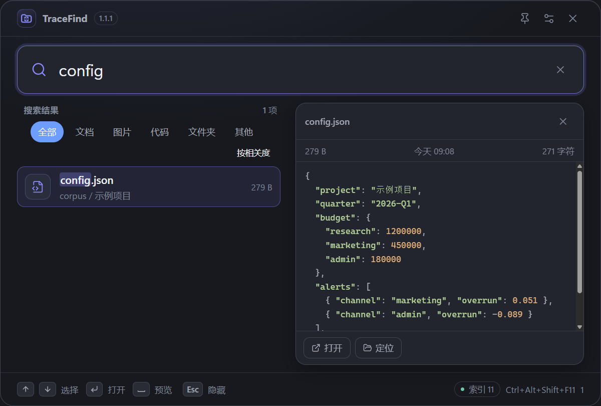
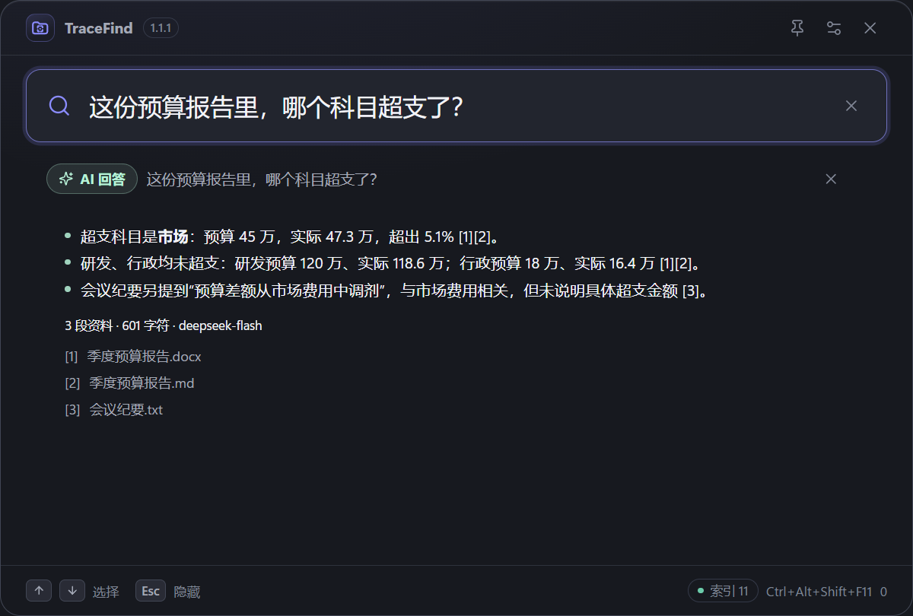
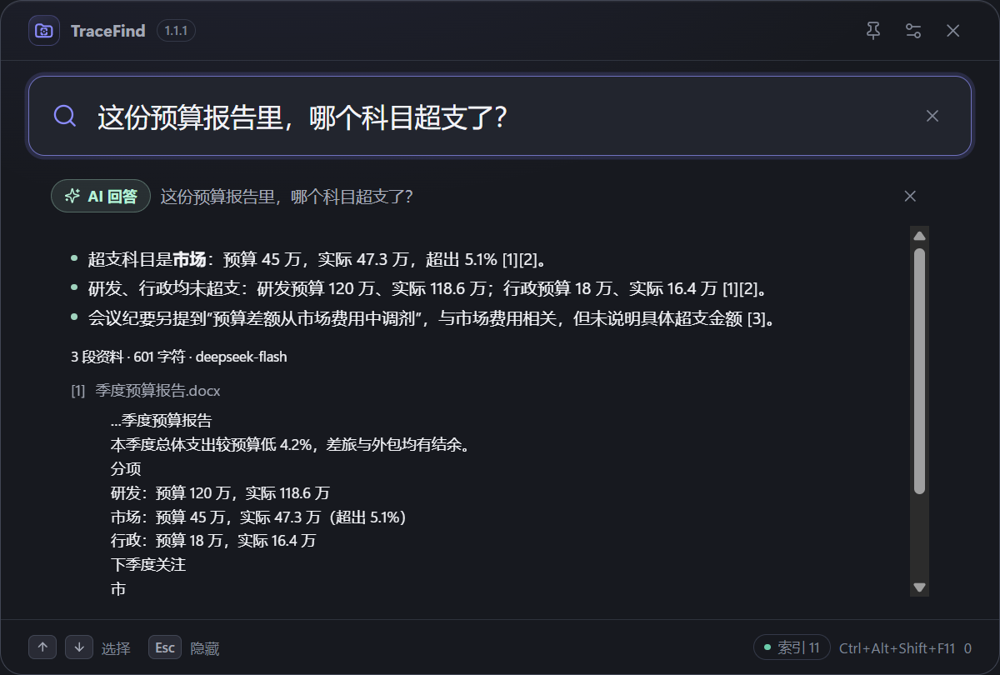

  

<h1 align="center">TraceFind · 寻迹</h1>

<strong>忘了文件名，记得一点也能找。</strong>

  Windows 本地文件搜索 · 文件名与拼音 · 正文与 OCR · 语义检索

  <a href="https://github.com/fanfanhappy/TraceFind/releases">下载 Windows 版</a> ·
  <a href="docs/release-1.1.1.md">1.1.0 发布说明</a> ·
  <a href="docs/DEVELOPMENT.md">开发指南</a> ·
  <a href="docs/DATA-AND-PRIVACY.md">数据与隐私</a>

## 怎么用

## 你还记得什么？

| 记得的线索 | 可以怎么找 |
| --- | --- |
| **文件名或几个首字母** | 输入文件名、路径或拼音。例如用 `cwysbg` 找「财务预算报告」。 |
| **文档里的一句话** | 用正文关键词搜索 Word、PDF、Markdown 或代码。结果会显示可用的命中片段。 |
| **扫描件或截图上的几个字** | 开启 Windows OCR，提取图片和扫描版 PDF 中的文字。 |
| **只记得大意** | 开启语义检索，按含义找相关材料。例如用「并购资金压力」查找讨论「融资约束」的文档。 |

可以按目录和文件类型缩小范围，按相关度、修改时间、名称或大小排序。找到候选后，用快速预览查看图片、分页文本或带语法高亮的代码，再决定打开哪一份。

## 界面

<table>
  <tr>
    <td width="50%"> 文档预览：正文直接可读，命中词高亮</td>
    <td width="50%"> 代码预览：语法高亮，长文件分页加载</td>
  </tr>
  <tr>
    <td width="50%"> 图片预览：不打开外部程序先看内容</td>
    <td width="50%"> 类型筛选：只看代码，范围和排序同步生效</td>
  </tr>
  <tr>
    <td width="50%"> 搜索与排序：相关度 / 时间 / 名称 / 大小</td>
    <td width="50%"> AI 与模型：本地模型或云端接口</td>
  </tr>
</table>
## AI 问答

按 `Ctrl + Shift + Enter`（`Ctrl + Enter` 仍是"在资源管理器中定位"）：先本地检索出最相关的几段正文，再交给你配置的云端模型作答，回答里标注 `[1][2]` 引用，来源可展开核对。

## 开始使用

1. 从 [GitHub Releases](https://github.com/fanfanhappy/TraceFind/releases) 获取 Windows x64 压缩包，解压后运行 `TraceFind.exe`。程序依赖 **WebView2 Runtime**。
2. 在 **设置 → 索引与扫描** 查看索引范围，把常用项目目录加进去。首次索引耗时随文件数量、格式和所启用的索引能力而变化。
3. 输入文件名或正文关键词。需要按大意查找时，在 **设置 → AI 与模型** 开启本地语义检索，首次使用会下载模型。

从 AURA Search 升级时，请先退出旧版，再运行 TraceFind。迁移条件和数据位置见 [1.1.0 发布说明](docs/release-1.1.1.md)。

## 常用快捷键

| 操作 | 按键 |
| --- | --- |
| 唤起或隐藏 | 默认 `Alt + Space`。发生冲突时，查看状态栏或托盘显示的实际组合。 |
| 选择与打开 | `↑` / `↓` 选择，`Enter` 打开 |
| 快速预览 | `Ctrl + Space` |
| 在资源管理器中定位 | `Ctrl + Enter` |
| 问 AI（检索到的正文作答） | `Ctrl + Shift + Enter` |
| 打开设置 | `Ctrl + ,` |
| 退出当前层级 | `Esc` |

## 本地与云端

文件名、正文、OCR 和本地语义检索都在电脑上运行。**云端嵌入**会向配置的接口发送查询和文档片段。**AI 文件助手**使用云端问答接口，会发送问题和检索到的资料。使用前请查看[数据流与当前版本的已知限制](docs/DATA-AND-PRIVACY.md)。

OCR 依赖 Windows 语言能力，扫描版 PDF 当前最多处理前 12 页。Office、PDF 的正文提取覆盖范围因文档结构而异。

## 项目文档

- [开发、构建与打包](docs/DEVELOPMENT.md)
- [TraceFind 1.1.0 发布说明](docs/release-1.1.1.md)
- [历史变更](docs/changelog-0.6.0.md)
- [反馈问题](https://github.com/fanfanhappy/TraceFind/issues)

采用 [MIT 许可证](LICENSE) © 2026 fanfanhappy：可自由使用、修改与分发，保留版权声明即可。